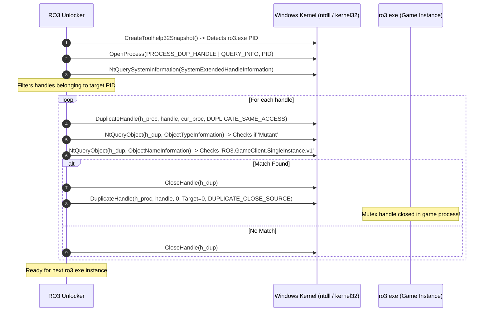

# RO3 Multi-Client Unlocker

Lightweight background monitor for running multiple simultaneous instances of the **RO3** game client (`ro3.exe`) on Windows without modifying binary files or injecting code.

---

## Overview

By default, `ro3.exe` limits execution to a single client per machine using a named Win32 Mutex:
```
RO3.GameClient.SingleInstance.v1
```
When a subsequent client starts, it checks if this mutant already exists. If found, the game immediately terminates.

**RO3 Unlocker** runs in the background, detects running instances of `ro3.exe`, queries the system handle table via native NTAPIs, and closes the Mutex handle inside the target process using `DUPLICATE_CLOSE_SOURCE`. Once the handle is closed, subsequent instances can launch without collision.

---

## How It Works



### Windows Internals Used

1. **Process Discovery**: `kernel32!CreateToolhelp32Snapshot`, `Process32First`, `Process32Next`.
2. **Handle Enumeration**: `ntdll!NtQuerySystemInformation` with `SystemExtendedHandleInformation (64)`.
3. **Handle Inspection**: `kernel32!DuplicateHandle` + `ntdll!NtQueryObject` (`ObjectTypeInformation` & `ObjectNameInformation`).
4. **Remote Closing**: `kernel32!DuplicateHandle` with `DUPLICATE_CLOSE_SOURCE (0x01)` to close the handle in the game process cleanly without memory alteration.

---

## Requirements

* **OS:** Windows 10 / Windows 11 (64-bit)
* **Privileges:** Administrator (required for `PROCESS_DUP_HANDLE` permissions)
* **Python:** Python 3.10+ (tested on Python 3.14). No external `pip` packages required (uses standard library `ctypes`).

---

## Usage

### Option 1: Direct Execution (Admin Prompt)

Open PowerShell or CMD as **Administrator**:

```cmd
python ro3_unlocker.py
```

### Option 2: Run via Batch File

Double-click `run_as_admin.bat`. It will automatically request UAC administrator elevation and start the monitoring loop.

### In-Game Flow:
1. Start `ro3_unlocker.py`.
2. Launch your first `ro3.exe` client.
3. The unlocker detects the PID and releases the mutex:
   ```
   [*] Instância detectada: PID 14208. Buscando Mutex...
   [+] Mutex 'RO3.GameClient.SingleInstance.v1' fechado com sucesso no PID 14208 (Handle: 0x240)!
   [OK] Cliente PID 14208 liberado! Você já pode abrir outra instância.
   ```
4. Launch your second, third, or nth client. Each will be automatically unlocked.
5. Press `Ctrl+C` to terminate the unlocker when finished.

---

## Security & Anticheat Safety

* **No DLL Injection:** Does not use `CreateRemoteThread`, `LoadLibrary`, or APC injection.
* **No Memory Patching:** Does not touch code sections (`.text`) or hook functions (`WriteProcessMemory`, `VirtualProtect`).
* **Non-Invasive:** Only closes the single-instance synchronization object handle. Game integrity checks remain untouched.

---

## License

MIT License. For educational and research purposes.
